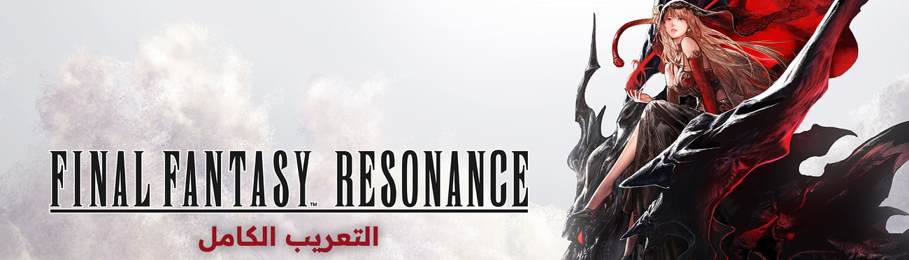

# FINAL FANTASY RESONANCE - التعريب الكامل

تعريب كامل لـFINAL FANTASY RESONANCE على Steam: القصة كلها والحوارات، والمهام الجانبية، وحوارات الرفاق، والقوائم، والأغراض، والمهارات، والشروحات ورسائل النظام، وصور الشروحات وشارات المعركة، مع خط Readex Pro. العربية لغة إضافية تظهر في قائمة لغات اللعبة باسم «العربية»، ولا تتغير الأصوات ولا اللغات الأخرى.

## التحميل

من صفحة [الإصدارات](../../releases/latest) حمّل ملف `FFResonance-Arabic-v1.0.5-beta.exe`.

أو حمّله من [Nexus Mods](https://www.nexusmods.com/finalfantasyresonance/mods/44).

## التثبيت

1. أغلق اللعبة.
2. شغّل المثبّت واضغط «تثبيت اللغة العربية». يجد المثبّت اللعبة تلقائيًا من مكتبة Steam، ويمكنك اختيار مجلدها يدويًا.
3. شغّل اللعبة واختر «العربية» من قائمة اللغة في الإعدادات.

إن ظهرت رسالة "Windows protected your PC" اضغط More info ثم Run anyway.

للإزالة: شغّل المثبّت واضغط «إزالة اللغة العربية».

## تنبيه

- صُمّم لإصدار Steam، رقم البناء 24250053. بعد أي تحديث للعبة انتظر نسخة جديدة من التعريب.
- بعض التعديلات مشتركة بين كل اللغات ما دام التعريب مثبّتًا: محاذاة بعض عناصر الواجهة وموضع سهم متابعة الحوار، وصور الشروحات في اللغة اليابانية، وشارات AMAZING وEXCELLENT وGOOD في اليابانية والإنجليزية.
- صور الشروحات التي هي لقطات من اللعبة تظهر بنسختها الإنجليزية.
- هذا إصدار بيتا؛ أخبرنا بأي نص غير مترجم أو خارج مكانه مع صورة في [Issues](../../issues).

## شكر وتقدير

- SQUARE ENIX على اللعبة.
- خط Readex Pro من تصميم Thomas Jockin وNadine Chahine، مرخّص برخصة SIL Open Font License 1.1.

أعجبك التعريب؟ ادعمني على Ko-fi: https://ko-fi.com/kindiboy

---

Full Arabic localization of FINAL FANTASY RESONANCE (Steam, build 24250053): the whole story, side quests, party chats, menus, items, skills, tutorials and system messages, with the Readex Pro font. Arabic is added as an extra language; voices and the other languages are unchanged, and the game's own files are not modified. Download the installer from [Releases](../../releases/latest) or [Nexus Mods](https://www.nexusmods.com/finalfantasyresonance/mods/44).

This is a fan project, not affiliated with or endorsed by SQUARE ENIX. FINAL FANTASY is a registered trademark of Square Enix Holdings Co., Ltd.
